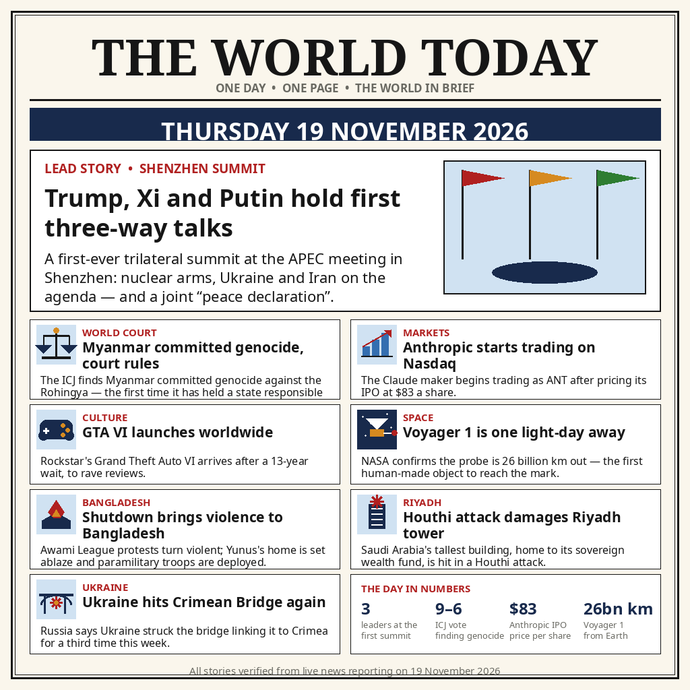

# The World Today — Thursday 19 November 2026

[](https://make.fun/bounty/news-image-20261119)
[](https://make.fun/bounty/news-image-20261119)
[](https://make.fun/bounty/news-image-20261119)

A 1024×1024 newspaper-front-page infographic summing up Thursday
19 November 2026 in one image — my entry for the
[news-image-20261119](https://make.fun/bounty/news-image-20261119)
competition on make.fun ($250, free entry).



## The stories

Every story on the page is a real event verified from live news reporting
on 19 November 2026 — nothing invented, nothing shown as fact that was not
reported that day.

**Lead story — the Shenzhen summit.** Donald Trump, Xi Jinping and
Vladimir Putin hold a first-ever three-way summit on the sidelines of the
APEC meeting in Shenzhen, discussing nuclear arms, Ukraine and Iran, and
issuing a joint "peace declaration" — but announcing no major agreement.
(AP, via The Korea Herald; Reuters via the Bangladesh Chronicle.)

**The other stories:**

- **World court** — the International Court of Justice rules that Myanmar
  committed genocide against the Rohingya in its 2017 clearance
  operations, the first time the court has found a state responsible for
  genocide; the 9–6 judgment orders restitution and reparations.
  (Al Jazeera, Channel News Asia, Amnesty International.)
- **Markets** — Anthropic, the maker of Claude, begins trading on Nasdaq
  under the ticker ANT after pricing its IPO at $83 a share.
  (Reuters; Inc.)
- **Culture** — Grand Theft Auto VI launches worldwide after a 13-year
  wait, to rave reviews. (Daily Mirror; NDTV.)
- **Space** — NASA confirms Voyager 1 is one light-day from Earth — about
  26 billion km — the first human-made object to reach the mark.
  (Reuters; NASA.)
- **Bangladesh** — an Awami League shutdown brings protests and violence;
  Muhammad Yunus's home is set ablaze and paramilitary troops are
  deployed. (Dawn; Daily Mirror.)
- **Riyadh** — a Houthi attack damages Riyadh's tallest building, home to
  Saudi Arabia's sovereign wealth fund. (AFP, via The Korea Herald.)
- **Ukraine** — Russia says Ukraine struck the Crimean Bridge for a third
  time this week. (Just Security Early Edition.)

**The day in numbers** — 3 leaders at the first trilateral summit; 9–6,
the ICJ vote finding genocide; $83, the Anthropic IPO price per share;
26bn km, Voyager 1's distance from Earth.

## How it is made

`draw.py` (Python 3 + Pillow only) draws the whole page: a serif
masthead ("THE WORLD TODAY"), a navy date band naming Thursday
19 November 2026, the lead story with a flat vector-style pictogram of
three summit flags over a round table, seven more stories each with a
short headline, a one-line summary and a small hand-drawn pictogram
(scales, chart, game controller, space probe, flame, skyscraper, bridge),
and a "day in numbers" box.

The drawing is fully deterministic — fixed content, no timestamps, no
randomness — so running `draw.py` twice produces byte-identical
`entry.png`.

`main.ts` (Node 22, standard library only) copies `entry.png` into the
output directory (`MAKEFUN_OUTPUT_DIR`, or `/output` by default).

## Reproduce

```sh
# 1. Draw the front page (writes entry.png, 1024x1024, under 1 MiB)
python3 draw.py

# 2. Check determinism: two runs must give the same sha256
python3 draw.py && sha256sum entry.png
python3 draw.py && sha256sum entry.png

# 3. Copy it to the output directory
mkdir -p out && MAKEFUN_OUTPUT_DIR=out node main.ts
cmp out/entry.png entry.png   # byte-identical
```

## License

MIT — see [LICENSE](LICENSE).
